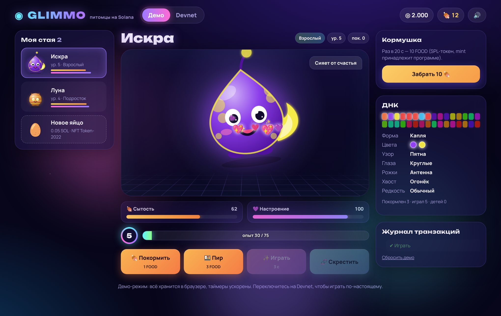
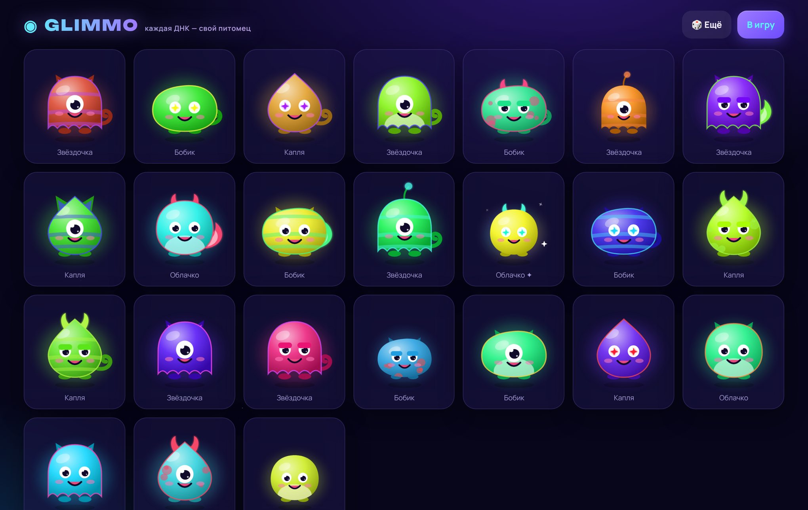
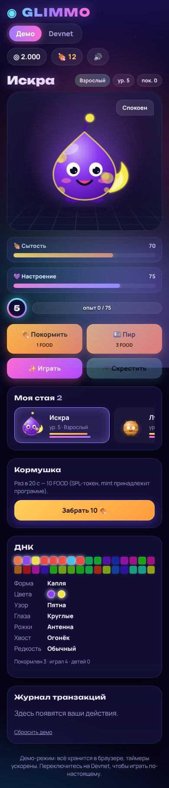

# Glimmo — светящиеся питомцы на Solana

Glimmo — игра, где каждый питомец является NFT в вашем кошельке. Купите яйцо, дождитесь, пока из него вылупится Глимм с уникальной ДНК, кормите его, играйте с ним, растите до взрослого и скрещивайте с другими: гены детей смешиваются от родителей и иногда мутируют. Каждое действие — транзакция в Solana.



| Скрещивание | Каждая ДНК — свой питомец |
|---|---|
|  |  |

## Что умеет игра

| Действие | Что происходит в блокчейне |
|---|---|
| **Кормушка** | Программа чеканит токены еды FOOD (SPL Token) на ваш кошелёк. Право чеканки принадлежит PDA программы, пауза между походами задаётся в конфиге. |
| **Новое яйцо** | Оплата SOL в казну (PDA), выпуск NFT на **Token-2022**: метаданные (имя, символ, URI, поля `generation` и `dna`) лежат прямо в mint, supply = 1, право чеканки после выпуска удаляется. Создаётся PDA `Pet` со случайной ДНК. |
| **Вылупить** | Работает только после `hatch_at` (время из sysvar `Clock`). |
| **Покормить** | Сжигает FOOD, повышает сытость, настроение и опыт. |
| **Играть** | Настроение и опыт растут, сытость немного падает, есть пауза между играми. |
| **Рост** | Сытость и настроение падают со временем (голодный питомец грустит вдвое быстрее). Уровни растут от опыта, на уровнях `teen_level` и `adult_level` питомец эволюционирует и меняет облик. |
| **Переименовать** | Меняет имя и в `Pet`, и в метаданных NFT (`token_metadata_update_field`). |
| **Скрестить** | Два взрослых питомца (можно двух **разных игроков**, оба подписывают) дают новое яйцо-NFT. Каждый ген берётся от случайного родителя, видимые гены с шансом 1/8 мутируют, поколение = max(родители) + 1. |
| **Передать NFT** | Обычный перевод Token-2022: управлять питомцем начинает новый владелец. |

## Как устроено

```
glimmo/
├─ programs/glimmo/src/
│  ├─ lib.rs              — точки входа (10 инструкций)
│  ├─ state.rs            — Config, Player, Pet, GameParams, формулы роста
│  ├─ genes.rs            — ДНК, случайность из SlotHashes, смешивание генов
│  ├─ nft.rs              — выпуск NFT на Token-2022 с метаданными
│  ├─ events.rs, errors.rs
│  └─ instructions/       — admin, food, adopt, care, breed
├─ tests/glimmo.ts        — 14 интеграционных тестов на локальном валидаторе
├─ scripts/               — test-local.sh, devnet-init.ts
└─ app/                   — веб-игра (Vite + React + Phantom)
```

**Аккаунты (PDA):**

| Аккаунт | Seeds | Зачем |
|---|---|---|
| `Config` | `["config"]` | админ, параметры игры, счётчик питомцев; mint authority для FOOD и NFT |
| `treasury` | `["treasury"]` | казна с оплатой за яйца (системный аккаунт без данных) |
| FOOD mint | `["food"]` | SPL-токен еды, decimals = 0 |
| `Player` | `["player", owner]` | когда брал еду, сколько яиц и потомства |
| NFT mint | `["pet_mint", id]` | Token-2022 mint с расширением MetadataPointer |
| `Pet` | `["pet", mint]` | ДНК, имя, уровень, опыт, сытость, настроение, таймеры, родители |

**Владение.** Программа не хранит владельца питомца: в каждой инструкции она проверяет, что у подписанта есть токен-аккаунт с этим NFT и балансом 1. Поэтому питомца можно продать или подарить обычным переводом токена.

**Время.** Голод не требует «крона»: при каждом действии программа считает, сколько интервалов `decay_seconds` прошло с `last_tick`, и применяет их разом (`Pet::apply_decay`). Интерфейс использует ту же формулу и показывает актуальные значения между транзакциями.

**ДНК → внешность.** 32 байта генов. Первые 8 видимые: форма тела, два цвета, узор, глаза, рожки/ушки, редкость (≈5% «сияющих») и хвост. Интерфейс рисует питомца из этих генов в SVG, детали зависят от стадии, а выражение лица от сытости и настроения.

**Случайность.** Используются хеш последнего слота из sysvar `SlotHashes`, время, ключи и счётчик. Для учебной игры этого достаточно. В игре с реальными деньгами нужен VRF (например, Switchboard), потому что валидатор теоретически может влиять на хеш слота.

**События:** `FoodClaimed`, `EggAdopted`, `Hatched`, `Fed`, `Played`, `LevelUp`, `Evolved`, `Bred`, `Renamed`. Интерфейс и тесты на них подписываются.

## Веб-игра

- **Демо-режим** работает без кошелька и интернета: та же логика в браузере с ускоренными таймерами. С него удобно начинать показ.
- **Devnet** — Phantom (Wallet Standard), настоящие транзакции, ссылки на Explorer в журнале.
- Живые питомцы: дышат, моргают, парят, прыгают от игры, жуют при кормлении, грустят и плачут, когда голодны. У взрослых появляются хвост, свечение и обводка, у «сияющих» радужная аура.
- Яйцо качается тем сильнее, чем ближе вылупление, и трескается. Есть частицы, баннеры уровня и эволюции, звуки на WebAudio (выключаются кнопкой 🔊).
- Окно скрещивания показывает гены обоих родителей рядом.
- `/?gallery` открывает витрину из 24 случайных ДНК: видно, насколько разными бывают питомцы.
- Вёрстка адаптирована под телефон.



## Запуск

Подробная пошаговая инструкция (WSL, деплой в devnet, проверка) — в [ЗАПУСК.md](ЗАПУСК.md).

```bash
# тесты программы (локальный валидатор)
npm install
npm test            # 14 passing
npm run test:unit   # юнит-тесты формул на Rust

# игра в браузере (демо-режим работает сразу)
cd app && npm install && npm run dev
```

## Тесты

`tests/glimmo.ts` проверяет:

1. initialize: конфиг, mint еды (authority = PDA), казна rent-exempt
2. update_params: чужой не может, неверные параметры отклоняются
3. claim_food: выдаёт FOOD и соблюдает паузу
4. adopt_egg: оплата в казну, NFT Token-2022 с метаданными, supply = 1, mint authority = None
5. яйцо нельзя кормить и вылупить раньше времени
6. hatch по таймеру, повторно нельзя
7. feed: FOOD сжигается, растут сытость и опыт, сытого не кормят
8. play: рост до взрослого, события `LevelUp` и `Evolved`
9. чужой не может играть с моим питомцем
10. rename: имя меняется в `Pet` и в метаданных NFT
11. breed: только взрослые и не сам с собой
12. breed двумя игроками: поколение, родители, наследование генов, списание FOOD, пауза
13. NFT можно передать: новый владелец ухаживает, старый больше не может
14. withdraw_treasury: только админ и не ниже ренты
