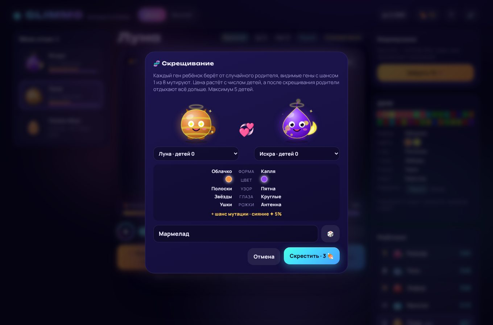

# Glimmo — светящиеся питомцы на Solana

Glimmo — игра, где каждый питомец является NFT в вашем кошельке. Купите яйцо, дождитесь, пока из него вылупится Глимм с уникальной ДНК, кормите его, играйте с ним, растите до взрослого и скрещивайте с другими: гены детей смешиваются от родителей и иногда мутируют. Каждое действие — транзакция в Solana.


| Скрещивание | Каждая ДНК — свой питомец |
|---|---|
|  |  |

**Сыграть с телефона:** демо-версия открывается по ссылке из PR, полная версия с devnet публикуется на GitHub Pages: https://kusherof.github.io/Solana-team/ (см. «Телефон» ниже).

## Что умеет игра

| Действие | Что происходит в блокчейне |
|---|---|
| **Новое яйцо** | Оплата SOL в казну (PDA), выпуск NFT на **Token-2022**: метаданные (имя, символ, URI, поля `generation` и `dna`) лежат прямо в mint, supply = 1, право чеканки после выпуска удаляется. В `Pet` записывается только номер будущего слота `seed_slot`, ДНК пока нет. |
| **Кормушка** | Открывается после первого яйца. Программа чеканит FOOD (SPL Token) на кошелёк, право чеканки у PDA, пауза задаётся в конфиге. |
| **Вылупить** | После `hatch_at`. ДНК считается из хеша слота `seed_slot` (sysvar `SlotHashes`) и записывается в метаданные NFT. |
| **Покормить** | Сжигает ровно столько FOOD, сколько питомец съел (лишнее не списывается). Растут сытость, настроение и опыт. |
| **Играть** | Настроение и опыт растут, сытость немного падает, есть пауза. |
| **Серия заботы и привязанность** | Каждый новый «день заботы» (`care_period`) подряд увеличивает серию 🔥 и привязанность 💞. Пропуск обнуляет серию и снижает привязанность. |
| **Множитель опыта** | Опыт × (настроение и серия): от ×0,33 у грустного питомца до ×1,5 у счастливого с длинной серией. |
| **Облик взрослого** | Каждый «голодный» период — промах ухода. На взрослой стадии облик фиксируется: «Сияющий» (0–1 промах), «Обычный» (2–4), «Ворчливый» (5+). |
| **Переименовать** | Имя до 20 символов (кириллица тоже) меняется и в `Pet`, и в метаданных NFT. |
| **Скрестить** | Два взрослых питомца (можно двух **разных игроков**, оба подписывают) дают яйцо-NFT. Гены родителей хранятся в яйце и смешиваются при вылуплении, видимые гены с шансом 1/8 мутируют. Не больше 5 детей, цена в FOOD растёт с числом детей, отдых удваивается. Родителя с ребёнком скрестить нельзя. |
| **Рейтинг** | Сайт собирает всех питомцев программы (`getProgramAccounts`) и сортирует по очкам: редкость генов, уровень, привязанность, поколение. |
| **Передать NFT** | Обычный перевод Token-2022: управлять питомцем начинает новый владелец. |

### Откуда механики

Идеи взяты у известных игр, названия, графика и код у Glimmo свои.

| Механика | Где подсмотрели |
|---|---|
| Облик взрослого зависит от ошибок ухода | Tamagotchi (care mistakes) |
| Серия ежедневной заботы и привязанность | Aavegotchi (kinship, «погладить» раз в период) |
| Лимит детей, растущая цена и пауза скрещивания | Axie Infinity (breed count), CryptoKitties (cooldown) |
| Мутации и редкие «сияющие» гены | CryptoKitties (mewtations), shiny из коллекционных игр |
| Очки редкости и рейтинг | Aavegotchi (rarity score) |
| ДНК неизвестна до вылупления | защита от «перебора» в on-chain играх с яйцами |

### Безопасность

- `initialize` может вызвать только upgrade authority программы (проверка через аккаунт `ProgramData`), поэтому игру нельзя «захватить» сразу после деплоя.
- ДНК нельзя подобрать: при покупке фиксируется будущий слот, хеш которого ещё не существует. Если вылупить слишком поздно и слот выпал из `SlotHashes`, берётся запасная ДНК, которая никогда не бывает сияющей, так что тянуть время невыгодно.
- Параметры игры проверяются на границы (`GameParams::validate`), все счётчики насыщающие.
- Кормушка закрыта для кошельков без питомцев, чтобы нельзя было бесплатно плодить FOOD.

## Как устроено

```
glimmo/
├─ programs/glimmo/src/
│  ├─ lib.rs              — точки входа (10 инструкций)
│  ├─ state.rs            — Config, Player, Pet, GameParams, формулы роста
│  ├─ genes.rs            — ДНК, случайность из SlotHashes, смешивание генов
│  ├─ nft.rs              — выпуск NFT на Token-2022 с метаданными
│  ├─ events.rs, errors.rs
│  └─ instructions/       — admin, food, adopt, care, breed
├─ tests/glimmo.ts        — 16 интеграционных тестов на локальном валидаторе
├─ scripts/               — test-local.sh, devnet-init.ts
└─ app/                   — веб-игра (Vite + React + Phantom)
```

**Аккаунты (PDA):**

| Аккаунт | Seeds | Зачем |
|---|---|---|
| `Config` | `["config"]` | админ, параметры игры, счётчик питомцев; mint authority для FOOD и NFT |
| `treasury` | `["treasury"]` | казна с оплатой за яйца (системный аккаунт без данных) |
| FOOD mint | `["food"]` | SPL-токен еды, decimals = 0 |
| `Player` | `["player", owner]` | когда брал еду, сколько яиц и потомства |
| NFT mint | `["pet_mint", id]` | Token-2022 mint с расширением MetadataPointer |
| `Pet` | `["pet", mint]` | ДНК, имя, уровень, опыт, сытость, настроение, таймеры, родители |

**Владение.** Программа не хранит владельца питомца: в каждой инструкции она проверяет, что у подписанта есть токен-аккаунт с этим NFT и балансом 1. Поэтому питомца можно продать или подарить обычным переводом токена.

**Время.** Голод не требует «крона»: при каждом действии программа считает, сколько интервалов `decay_seconds` прошло с `last_tick`, и применяет их разом (`Pet::apply_decay`). Интерфейс использует ту же формулу и показывает актуальные значения между транзакциями.

**ДНК → внешность.** 32 байта генов. Первые 8 видимые: форма тела, два цвета, узор, глаза, рожки/ушки, редкость (≈5% «сияющих», 25% у детей двух сияющих) и хвост. Интерфейс рисует питомца из этих генов в SVG, детали зависят от стадии и облика, а выражение лица от сытости и настроения.

**Случайность.** Хеш слота `seed_slot` из sysvar `SlotHashes` плюс ключ mint. В момент покупки этого хеша ещё нет, поэтому ни игрок, ни клиент не знают будущую ДНК. Валидатор теоретически может влиять на хеш своего слота, поэтому для игры с реальными деньгами нужен VRF (например, Switchboard).

**События:** `FoodClaimed`, `EggAdopted`, `Hatched`, `Fed`, `Played`, `LevelUp`, `Evolved`, `Bred`, `Renamed`. Интерфейс и тесты на них подписываются.

## Веб-игра

- **Демо-режим** работает без кошелька: та же логика в браузере с ускоренными таймерами («день заботы» длится минуту). С него удобно начинать показ.
- **Devnet**: Phantom (Wallet Standard), настоящие транзакции, ссылки на Explorer в журнале.
- Живые питомцы: дышат, моргают, парят, прыгают от игры, жуют при кормлении, грустят и засыпают, когда им плохо. Питомца можно погладить нажатием. У «сияющего» облика нимб, у «ворчливого» хмурые брови.
- Всплывающие числа (+сытость, +опыт, серия), вспышка при вылуплении, баннеры уровня и эволюции, фон сцены меняется со стадией, звуки на WebAudio.
- Окно скрещивания показывает гены обоих родителей, цену и все причины, почему скрестить пока нельзя.
- Панель рейтинга, редкость каждого питомца, кнопка «?» с правилами.
- `/?gallery` открывает витрину из 24 случайных ДНК.

### Телефон

- Вёрстка рассчитана на экран телефона.
- Демо без кошелька открывается по ссылке из описания PR.
- Полная версия публикуется на GitHub Pages workflow-ом `.github/workflows/glimmo-pages.yml` после слияния в `main`. Один раз включите: **Settings → Pages → Source: GitHub Actions**. Адрес: https://kusherof.github.io/Solana-team/
- В мобильном браузере расширений кошельков нет, поэтому на телефоне сайт показывает кнопку «открыть игру в Phantom»: она открывает страницу во встроенном браузере приложения Phantom, где кошелёк подключается как обычно.


## Запуск

Подробная пошаговая инструкция (WSL, деплой в devnet, проверка) — в [ЗАПУСК.md](ЗАПУСК.md).

```bash
# тесты программы (локальный валидатор)
npm install
npm test            # 16 passing
npm run test:unit   # юнит-тесты формул на Rust

# игра в браузере (демо-режим работает сразу)
cd app && npm install && npm run dev
```

## Тесты

`tests/glimmo.ts` проверяет:

1. initialize: только upgrade authority может создать игру
2. update_params: чужой не может, неверные и огромные значения отклоняются
3. claim_food: без питомца кормушка закрыта
4. adopt_egg: оплата, NFT Token-2022, supply = 1, ДНК ещё не известна
5. claim_food: хозяину выдаёт FOOD и соблюдает паузу
6. яйцо нельзя кормить и нельзя вылупить раньше времени
7. hatch: ДНК выпадает при вылуплении и попадает в метаданные NFT
8. feed: сжигает FOOD, а лишнюю еду не списывает
9. play и рост: множитель от настроения, эволюция и облик по уходу
10. чужой не может играть с моим питомцем
11. rename: 20 кириллических символов, имя меняется и в NFT
12. breed: только взрослые и не сам с собой
13. breed: два игрока, гены родителей хранятся в яйце, цена и усталость
14. детёныш вылупляется со смешанными генами, с родителем скрестить нельзя
15. NFT можно передать: новый владелец ухаживает, старый нет
16. withdraw_treasury: только админ и не ниже ренты

Юнит-тесты на Rust (`npm run test:unit`) проверяют формулы голода, опыта, серии, смешивания генов, редкость сияния и растущую цену скрещивания.
