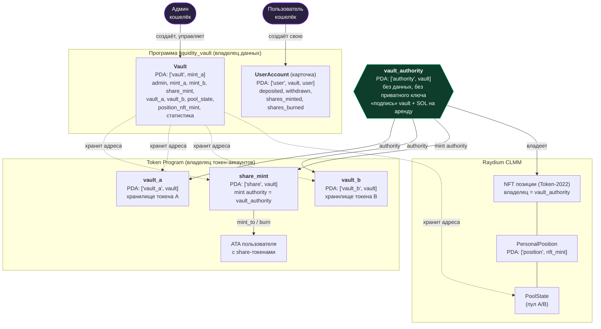

# Liquidity Vault — недели 8–15

Учебный DeFi-vault на Solana (Anchor 0.31 + Raydium CLMM).

Пользователи вносят токен **A** в общий «котёл» и получают **share-токены** — квитанцию о своей доле.
Администратор размещает средства в пуле с концентрированной ликвидностью **Raydium CLMM**, и они зарабатывают комиссии.
Когда пользователь выходит, он сжигает share-токены и забирает свою долю, уже вместе с заработанным.
Так устроены Kamino, Meteora и Yearn. Здесь упрощённая учебная версия с теми же механиками.

> Работаем только в **localnet / devnet**. В репозитории нет ключей и seed-фраз (`*-keypair.json` в `.gitignore`).

---

## Содержание

1. [Что сделано по неделям](#что-сделано-по-неделям)
2. [Схема аккаунтов](#схема-аккаунтов)
3. [Инструкции программы](#инструкции-программы)
4. [Учёт долей (share-токены)](#учёт-долей-share-токены)
5. [CPI: кто подписывает](#cpi-кто-подписывает)
6. [Raydium CLMM: пул, swap, позиция](#raydium-clmm-пул-swap-позиция)
7. [Как запустить](#как-запустить)
8. [Devnet: адреса и транзакции](#devnet-адреса-и-транзакции)
9. [Веб-интерфейс](#веб-интерфейс)
10. [Тесты](#тесты)
11. [Структура проекта](#структура-проекта)
12. [Задания для практики из методички](#задания-для-практики-из-методички)
13. [Ограничения учебной версии и что дальше](#ограничения-учебной-версии-и-что-дальше)

---

## Что сделано по неделям

| Неделя | Тема | Что в коде |
|---|---|---|
| 8 · РК1 | Каркас vault | `initialize_vault` создаёт настройки, share-mint и хранилище. `open_user_account` создаёт карточку пользователя (PDA) |
| 9 | Депозит и share-токены | `deposit`: расчёт share, перевод от пользователя, выпуск share от имени PDA. Депозит 0 запрещён |
| 10 | CPI и вывод | `withdraw`: сжигание share (подпись пользователя) и перевод из хранилища (подпись PDA через `invoke_signed`) |
| 11 | AMM и CLMM | `scripts/devnet/01-setup-pool.ts`: свои токены, свой CLMM-пул Raydium, своя позиция вручную |
| 12 | Swap через Raydium | `configure_pool` (второе хранилище) и `swap` через CPI в Raydium `swap_v2` с минимумом (защита от slippage) |
| 13 | Позиция в CLMM | `open_position`, `collect_fees`, `close_position` через CPI в Raydium. Ребалансировка в тестах |
| 14 | Capstone | Веб-интерфейс `app/`: кошелёк, карточка, внести/вывести с подсказкой «получите ≈», проверка ввода, понятные ошибки, история операций, мгновенное обновление, страница админа. `npm run faucet` для тестеров, тесты сайта (vitest) |
| 15 · РК2 | Demo Day | Живое демо через веб-интерфейс: внести → обмен → позиция → комиссии → закрыть → вывести |

---

## Схема аккаунтов



| Аккаунт | Адрес (seeds) | Владелец (owner) | Что хранит | Зачем |
|---|---|---|---|---|
| **Vault** | `["vault", mint_a]` | программа vault | админ, mint-ы, адреса хранилищ, пул, текущая позиция, статистика | Настройки. По нему программа проверяет, что ей передали правильные аккаунты (`has_one`) |
| **vault_authority** | `["authority", vault]` | System Program | только SOL | «Подпись» vault. Владеет хранилищами и NFT позиции, выпускает share. Платит аренду за аккаунты Raydium |
| **share_mint** | `["share", vault]` | Token Program | supply share-токенов | Квитанции о доле. Mint authority = PDA, поэтому выпустить share может только программа |
| **vault_a** | `["vault_a", vault]` | Token Program | токены A | Здесь физически лежат депозиты |
| **vault_b** | `["vault_b", vault]` | Token Program | токены B | Второе хранилище для токена пула (неделя 12) |
| **UserAccount** | `["user", vault, user]` | программа vault | сколько внёс/вывел пользователь | Карточку можно найти по адресу пользователя, список пользователей хранить не нужно |

**Почему два PDA (`vault` и `vault_authority`)?** `vault` хранит данные, поэтому им владеет наша программа.
Raydium при открытии позиции списывает с «плательщика» SOL на аренду новых аккаунтов (NFT, tick arrays) через System Program,
а System Program умеет списывать SOL только с аккаунтов, которыми владеет он сам.
Поэтому «подписантом» vault служит отдельный PDA без данных, и при создании vault на него переводится немного SOL.

---

## Инструкции программы

| Инструкция | Кто вызывает | Что делает |
|---|---|---|
| `initialize_vault(authority_lamports)` | админ | Создаёт Vault, share_mint, vault_a и пополняет vault_authority SOL-ом |
| `open_user_account()` | пользователь | Создаёт карточку пользователя |
| `deposit(amount)` | пользователь | Токены A → vault_a, share-токены → пользователю. Минимум 1 токен (`DepositTooSmall`) |
| `withdraw(shares)` | пользователь | Сжигает share, токены A → пользователю |
| `withdraw_all()` | пользователь | То же, что `withdraw`, но сжигает все share пользователя за один вызов |
| `close_user_account()` | пользователь | Закрывает карточку, если share не осталось (`CardNotEmpty`), рента возвращается пользователю |
| `configure_pool()` | админ | Привязывает CLMM-пул (проверяет, что в нём токен A) и создаёт vault_b |
| `swap(amount_in, minimum_amount_out, sqrt_price_limit_x64, a_to_b)` | админ | CPI в Raydium `swap_v2`. A → B не больше 50% токена A vault за раз (`SwapTooLarge`) |
| `open_position(tick_lower, tick_upper, …, liquidity, amount_0_max, amount_1_max)` | админ | CPI в Raydium `open_position_with_token22_nft`, NFT достаётся vault_authority |
| `collect_fees()` | админ | CPI в Raydium `decrease_liquidity_v2` с ликвидностью 0: забирает только комиссии |
| `increase_liquidity(liquidity, amount_0_max, amount_1_max)` | админ | CPI `increase_liquidity_v2`: доложить свободные токены vault (например, собранные комиссии) в открытую позицию |
| `close_position(amount_0_min, amount_1_min)` | админ | CPI `decrease_liquidity_v2` (вся ликвидность) + CPI `close_position` (сжечь NFT) |

Все «админские» инструкции проверяют `has_one = admin`. Подпись чужого кошелька даёт ошибку `Unauthorized`.
**Админ не может забрать токены себе:** ни одна инструкция не переводит токены на произвольный адрес.
Токены уходят только пользователю при `withdraw` или в пул Raydium, а возвращаются в хранилища vault.

Ошибки программы: [`errors.rs`](programs/liquidity-vault/src/errors.rs). События для логов: [`events.rs`](programs/liquidity-vault/src/events.rs).

---

## Учёт долей (share-токены)

Код: [`math.rs`](programs/liquidity-vault/src/math.rs), там же unit-тесты.

```
первый депозит:      shares = amount
следующие депозиты:  shares = amount × total_shares ÷ total_assets
вывод:               amount = shares × total_assets ÷ total_shares
```

`total_assets` = баланс `vault_a`, `total_shares` = supply share-токена. Деление с округлением вниз, то есть в пользу vault:
тот, кто вносит и сразу выводит, не может «выиграть» на округлении.

**Пример из методички (он же есть в тестах).** В vault 1 000 токенов и 1 000 share. Vault заработал, и стало 1 100 токенов.
Новый пользователь вносит 110 и получает `110 × 1000 ÷ 1100 = 100` share. Это меньше, чем он внёс, потому что каждый share теперь стоит 1.1 токена.
Так поздний вкладчик не забирает доход тех, кто был раньше.

---

## CPI: кто подписывает

| Действие | Программа, которую вызываем | Кто подписывает | Как |
|---|---|---|---|
| Перевод A от пользователя в vault_a | Token Program `transfer_checked` | **пользователь** | его подпись из транзакции «передаётся» в CPI (`CpiContext::new`) |
| Выпуск share | Token Program `mint_to` | **программа** за PDA `vault_authority` | `CpiContext::new_with_signer` с seeds `["authority", vault, bump]` |
| Сжигание share при выводе | Token Program `burn` | **пользователь** | `CpiContext::new` |
| Перевод A из vault_a пользователю | Token Program `transfer_checked` | **программа** за PDA | `new_with_signer` |
| swap / open / collect / close | Raydium CLMM | **программа** за PDA | `new_with_signer`. Внутри Raydium сам делает CPI в Token Program |

**Что видно в транзакции вывода в Explorer** (раздел *Inner Instructions*): внутри инструкции `withdraw` нашей программы два вызова Token Program,
`Burn` (share-токены пользователя) и `TransferChecked` (из `vault_a` пользователю, authority = `vault_authority`).
Это и есть CPI. Тест `вывод: сжигаем share…` проверяет, что их ровно два.

**Почему админ не может просто забрать токены своей подписью:** владелец `vault_a` — PDA `vault_authority`.
У PDA нет приватного ключа (адрес лежит вне кривой ed25519), и «подписать» за него может только наша программа через `invoke_signed`.
Программа делает это только в коде `withdraw`, `swap` и в инструкциях позиции.

---

## Raydium CLMM: пул, swap, позиция

Для CPI используется официальная библиотека Raydium (`raydium-amm-v3`, репозиторий `raydium-io/raydium-clmm`),
зафиксированная на коммите `d4ec101`. Это версия с Anchor 0.31, а интерфейс нужных нам инструкций совпадает с текущей программой в devnet.

- **Программа Raydium CLMM в devnet:** `DRayAUgENGQBKVaX8owNhgzkEDyoHTGVEGHVJT1E9pfH` (включается флагом сборки `--features devnet`)
- **В localnet/mainnet:** `CAMMCzo5YL8w4VFF8KVHrK22GGUsp5VTaW7grrKgrWqK`

### Цена, тики, диапазон

- Цена в пуле — сколько `token_1` за 1 `token_0` (токены в пуле упорядочены по адресу).
- Цена разбита на **тики**: `price = 1.0001^tick`. Позицию можно открыть только на тиках, кратных `tick_spacing` пула.
- **Выбор диапазона:** текущая цена ± типичное колебание за период. Мы берём **±10%**, примерно ±1000 тиков.
  Узкий диапазон заработал бы больше комиссий, но цена чаще выходила бы из него, и пришлось бы чаще ребалансировать.
- Пока цена внутри диапазона, позиция содержит оба токена и зарабатывает комиссии.
  Если цена уходит **выше** верхней границы, позиция целиком превращается в `token_1` (весь `token_0` продан) и перестаёт зарабатывать.
  Если **ниже** нижней, она целиком в `token_0`. Тогда админ закрывает позицию и открывает новую вокруг новой цены (ребалансировка).

### Swap и slippage

`swap` вызывает `swap_v2` с `is_base_input = true`: точная сумма на входе и `minimum_amount_out` на выходе.
Ожидаемую сумму клиент узнаёт **симуляцией той же транзакции** (`.simulate()`, читаем событие `SwapEvent`) и ставит минимум на 1% ниже.
Если пул отдаёт меньше минимума, Raydium откатывает всю транзакцию с ошибкой `TooLittleOutputReceived` (код 6018).

### Позиция

- `open_position`: vault кладёт в пул оба токена в выбранном диапазоне и получает NFT позиции (Token-2022), который принадлежит `vault_authority`.
  `amount_0_max/amount_1_max` — максимум, который vault готов отдать.
- `collect_fees`: `decrease_liquidity_v2` с ликвидностью 0. Raydium переводит накопленные комиссии в хранилища vault.
- `close_position`: выводим всю ликвидность с минимумами `amount_0_min/amount_1_min` (защита от slippage), затем Raydium сжигает NFT и возвращает аренду.

---

## Как запустить

> Подробная пошаговая инструкция с нуля для Windows (WSL, установка всех инструментов, ожидаемый вывод, частые ошибки): **[ЗАПУСК.md](ЗАПУСК.md)**.

### Что нужно

- Rust, [Solana CLI 2.1.x](https://solana.com/docs/intro/installation), Anchor CLI **0.31.1** (`avm install 0.31.1 && avm use 0.31.1`), Node.js 20+.
- На Windows удобнее всего через **WSL2 (Ubuntu)**: Anchor и `solana-test-validator` под Windows работают плохо.

```bash
cd week8-15-liquidity-vault
npm install
```

### Сборка и тесты (localnet)

```bash
# 1. Один раз: собрать программу Raydium CLMM для локального валидатора (~3 минуты)
npm run build:raydium-local

# 2. Unit-тесты математики долей
npm run test:unit

# 3. Интеграционные тесты: весь сценарий от создания vault до вывода, с настоящим Raydium CLMM
npm test
```

`npm test` запускает `scripts/test-local.sh`: собирает программу, поднимает `solana-test-validator` с нашей программой и Raydium и запускает `anchor test`.

> **Program ID.** В `declare_id!` и `Anchor.toml` записан адрес программы, задеплоенной в devnet (`96NuHq…`).
> Локальные тесты загружают программу в валидатор по этому же адресу, ключ для этого не нужен.
> Ключ программы в репозиторий не попадает. Если хотите задеплоить **свою** копию, выполните `anchor keys sync`
> (он запишет адрес из `target/deploy/liquidity_vault-keypair.json`) и пересоберите.

### Деплой в devnet

```bash
solana config set --url devnet
solana airdrop 2                      # или https://faucet.solana.com (нужно ~5 SOL на деплой)
npm run build:devnet                  # сборка с адресом Raydium CLMM для devnet
anchor deploy --provider.cluster devnet
```

### Обновить программу в devnet (после изменений в контракте)

Программа обновляется по тому же адресу: нужен тот же `target/deploy/liquidity_vault-keypair.json`, что и при первом деплое.
Новые инструкции не меняют формат аккаунтов, поэтому старый vault в devnet продолжает работать.

```bash
npm run build:devnet
anchor deploy --provider.cluster devnet
# если пишет «account data too small»: программа выросла, добавьте места и повторите деплой
solana program extend 96NuHqGCDcUKWXGNuHZeS1wpeMTrpc64Jnh5jVxyLRuU 50000 --url devnet
```

### Сценарий в devnet (каждая команда печатает ссылку на Explorer и сохраняет её в `deployments/devnet.json`)

```bash
npm run devnet:pool                   # неделя 11: токены A и B, CLMM-пул, своя позиция ±10%
npm run vault -- init                 # неделя 8: vault + карточка
npm run vault -- deposit 1000         # неделя 9
npm run vault -- withdraw 100         # неделя 10
npm run vault -- configure            # неделя 12: привязать пул, создать хранилище B
npm run vault -- swap a2b 450         # неделя 12: успешный обмен (минимум −1%)
npm run vault -- swap-fail a2b 100    # неделя 12: обмен, отклонённый из-за slippage
npm run vault -- open 10              # неделя 13: позиция ±10%
npm run vault -- trade 4 200          # обмены «другого трейдера» → комиссии
npm run vault -- collect              # неделя 13: собрать комиссии
npm run vault -- close                # неделя 13: закрыть позицию
npm run vault -- swap b2a all         # вернуть весь B в A
npm run vault -- withdraw 900         # вывести остаток
npm run vault -- status               # состояние vault и пула

# после обновления программы:
npm run vault -- withdraw-all         # вывести все свои share одной транзакцией
npm run vault -- close-card           # закрыть пустую карточку, вернуть ренту
npm run vault -- increase             # (при открытой позиции) доложить собранные комиссии в позицию
npm run faucet -- <адрес> [сумма]     # неделя 14: тестеру 1000 токенов A и 0.02 SOL, если у него меньше 0.01
```

Все devnet-скрипты сначала проверяют, что RPC действительно devnet (по хешу первого блока): если в `ANCHOR_PROVIDER_URL`
по ошибке указан mainnet, скрипт остановится до любой транзакции.

Те же скрипты можно прогнать на локальном валидаторе: `CLUSTER=localnet npm run devnet:pool` и т.д.

---

## Devnet: адреса и транзакции

Программа развёрнута в devnet, весь сценарий из [`ЗАПУСК.md`](ЗАПУСК.md) пройден. Адреса и подписи транзакций лежат в [`deployments/devnet.json`](deployments/devnet.json).

**Адреса**

| Что | Адрес |
|---|---|
| Программа `liquidity_vault` | [`96NuHqGCDcUKWXGNuHZeS1wpeMTrpc64Jnh5jVxyLRuU`](https://explorer.solana.com/address/96NuHqGCDcUKWXGNuHZeS1wpeMTrpc64Jnh5jVxyLRuU?cluster=devnet) |
| Raydium CLMM (devnet) | [`DRayAUgENGQBKVaX8owNhgzkEDyoHTGVEGHVJT1E9pfH`](https://explorer.solana.com/address/DRayAUgENGQBKVaX8owNhgzkEDyoHTGVEGHVJT1E9pfH?cluster=devnet) |
| Админ (кошелёк) | [`6Php2APfxdt14DZG7Wruq2kPpRcjWpQkir5TX29nU3Kn`](https://explorer.solana.com/address/6Php2APfxdt14DZG7Wruq2kPpRcjWpQkir5TX29nU3Kn?cluster=devnet) |
| Токен A | [`3EzwLJ6DsngqAqror8iZWzYeQe1fbGrtngCCDfeenpXq`](https://explorer.solana.com/address/3EzwLJ6DsngqAqror8iZWzYeQe1fbGrtngCCDfeenpXq?cluster=devnet) |
| Токен B | [`CCWRbhSb8BYnuPureBfVCSLiAorPFpwKm7DGLwn4yZBU`](https://explorer.solana.com/address/CCWRbhSb8BYnuPureBfVCSLiAorPFpwKm7DGLwn4yZBU?cluster=devnet) |
| AmmConfig (tickSpacing 60, комиссия 0.25%) | [`CD4aJtX11cqTCAc83nxSPkkh5JW2yjD6uwHeovjqQ1qu`](https://explorer.solana.com/address/CD4aJtX11cqTCAc83nxSPkkh5JW2yjD6uwHeovjqQ1qu?cluster=devnet) |
| CLMM-пул Raydium | [`D69RAEuzoJZrjnyfvrR4L89Nu6oE8jN27dGKq4ftvDAA`](https://explorer.solana.com/address/D69RAEuzoJZrjnyfvrR4L89Nu6oE8jN27dGKq4ftvDAA?cluster=devnet) |
| Своя позиция, NFT (нед. 11) | [`Bf6vDGqSdm5nDQUz98Kob7LMREvoE9RqSNA7c4Cy2qUW`](https://explorer.solana.com/address/Bf6vDGqSdm5nDQUz98Kob7LMREvoE9RqSNA7c4Cy2qUW?cluster=devnet) |
| Vault | [`5Whod5S2vALvitfQf5pGzn9tvPwvsdh1Xuz9N4bp5vdv`](https://explorer.solana.com/address/5Whod5S2vALvitfQf5pGzn9tvPwvsdh1Xuz9N4bp5vdv?cluster=devnet) |
| vault_authority | [`AvZSdTzWBDSqCrmara5tLGcEVQSdw56nMdQfjFYG8NYa`](https://explorer.solana.com/address/AvZSdTzWBDSqCrmara5tLGcEVQSdw56nMdQfjFYG8NYa?cluster=devnet) |
| share_mint | [`2b92EVKgiWAdN3o3j5ye5MdkQ3VFYG6vfw7dvFjoJ7ag`](https://explorer.solana.com/address/2b92EVKgiWAdN3o3j5ye5MdkQ3VFYG6vfw7dvFjoJ7ag?cluster=devnet) |
| Хранилище vault_a | [`5yK7bNvLhSFQZYx11aF91SS15qcnvJSNfZWsrRgBucT3`](https://explorer.solana.com/address/5yK7bNvLhSFQZYx11aF91SS15qcnvJSNfZWsrRgBucT3?cluster=devnet) |
| Хранилище vault_b | [`Gj3kFUu6eRWDVNKAthVpxVbWpvt8wTS31BgzJADbhy8m`](https://explorer.solana.com/address/Gj3kFUu6eRWDVNKAthVpxVbWpvt8wTS31BgzJADbhy8m?cluster=devnet) |

**Транзакции** (в порядке выполнения)

| # | Шаг | Транзакция | Результат |
|---|---|---|---|
| 1 | Создание пула (нед. 11) | [TezJ838Z…](https://explorer.solana.com/tx/TezJ838Z3fHkAFzfUK7X7SvayLo74Tq5pKRuo6HZDEcuydGwpLaNpxyAUwj5shNVqdKDQnL5ahazpgjscp36UUR?cluster=devnet) | начальная цена 1 B за 1 A |
| 2 | Своя позиция (нед. 11) | [5qDtwVqh…](https://explorer.solana.com/tx/5qDtwVqhGLYpnF7zH7RQdQ3uCoayAs5aYmzZYRasDoM1dA6A7d9Ti5qv3S9ZzP9gPVPjHnEcyH8ynn7vg7rUdoxf?cluster=devnet) | тики [−1080, 960] = 0.8976 … 1.1008 |
| 3 | Создание vault (нед. 8) | [4Kwajkii…](https://explorer.solana.com/tx/4KwajkiiDckqTPwAddWLCpjVsgkxmL8VMSkB5bP8u3AfpEbJgTzn9N4JsDaaQmrB3GTDB3BcWTftX9VeysXRLapA?cluster=devnet) | |
| 4 | Карточка пользователя (нед. 8) | [HXYmqVw9…](https://explorer.solana.com/tx/HXYmqVw9NaWbYtsfq6NTLErkpJkEgcFueYrbJvEnC5HjY5GJVL5Aj9Xw1FJJ3DowGcLHxurmsvj6gHLF3QWRGsZ?cluster=devnet) | |
| 5 | Депозит 1000 A (нед. 9) | [5ubKiBLe…](https://explorer.solana.com/tx/5ubKiBLecmUFYQd2pBoRKNPwXo5r5K9EUpe8JuYVkNfWfLtr4aiCqBytHv9MymM2dJKWcouUgstW8QvfBm2LFXX4?cluster=devnet) | выпущено 1000 share |
| 6 | Вывод 100 share (нед. 10) | [5dVHNQaH…](https://explorer.solana.com/tx/5dVHNQaHH2SPaR63bN2UQmDPeaZrJhizrVwaxQ9Lk9jEbEbrDPkvbroHK3DmZtp9zw5gPsPCVuasmeAmNHan9cc6?cluster=devnet) | в vault осталось 900 A |
| 7 | Привязка пула (нед. 12) | [4CV81dxZ…](https://explorer.solana.com/tx/4CV81dxZxNpnA3EZata36vFqLvByciqN2XB6S3VmW7GGSCpLGWLPGZcpgXpEtG5VExasa6i79sChsNKSypeUFLjV?cluster=devnet) | |
| 8 | Обмен 450 A → B (нед. 12) | [5TVhsawb…](https://explorer.solana.com/tx/5TVhsawbNJ7Eu4Su5iXT9HU9FS9CWhZsGRHVtTMsjBPg295Pzxu82hHRuvLsd2qtRsbfpn6yPLsHUQnD7giL8s6x?cluster=devnet) | получено 447.81 B (минимум 443.33), тик 0 → −48 |
| 9 | Обмен с минимумом +50% (нед. 12) | [cYPxXZGq…](https://explorer.solana.com/tx/cYPxXZGq7KPSa6DmeGpD42WxfJ6bi9fVw7CNEby8m9srZKkDM8vAZWRNHiKehAgzxQ1yaceihASr9VYMgH4TBH1?cluster=devnet) | отклонён: `TooLittleOutputReceived` (6018), цена не изменилась |
| 10 | Открытие позиции (нед. 13) | [foAB6VEa…](https://explorer.solana.com/tx/foAB6VEa3kbUXQSn2qS9aTztAYQ59oF8rz8md2kJ6pbCGqbdPYWsYAo97RoJP2CBjunZRWN1y5g4VVyAG1kcJw2?cluster=devnet) | тики [−1140, 960] = 0.8923 … 1.1008, NFT [`33xUGni3wtNnVBitS43hqpUt7bLGeQh8aikyyP9iVDn6`](https://explorer.solana.com/address/33xUGni3wtNnVBitS43hqpUt7bLGeQh8aikyyP9iVDn6?cluster=devnet) |
| 11 | 8 обменов трейдера по 200 | [1](https://explorer.solana.com/tx/32JH5zhEzJ6eXFeUsxgRz3D3xtSfVTKmSDxm7kYeZVN4VaWDyM2ghx9i3f2nXNCb4NKc8z6SJgTFf4N1T3Q57VF?cluster=devnet) · [2](https://explorer.solana.com/tx/2V3UMD6jDVfVUQpLHyE3xcueyA9Jjae2YjyyGbcgJpykAGRDHd7jhDbuBo9CyTgdvKVt3PbM64Kd7idBRNmYggN8?cluster=devnet) · [3](https://explorer.solana.com/tx/37E2TFRbY3aNfozEY3hbKCiuny2nuMQtEHwQ4Rai2bVhTqaVKh1D5R97G8RHR7q6AgmcXhqCrsdgz5btSArZrEvg?cluster=devnet) · [4](https://explorer.solana.com/tx/38hQZPbJZr3cEbJ4YgikFaNdheqHqqp5iHP6ipRfSvpZput2LBKmiq6y1NCEopXhb1mYGpn1Gq2XwxXeeXp8sy3G?cluster=devnet) · [5](https://explorer.solana.com/tx/5YhUWEyNCyj63Szwrq5dyxrz8bRYjG7EwiKUGiY8XTKtwhNihLRTiZGgkcLSnjzrENnhCCyFLnLHTejGr4xSgBLD?cluster=devnet) · [6](https://explorer.solana.com/tx/4TQXpcjshJZbMmUPAvx8kTJbCT92nEeipuXVAk7x818ok6JyhVHdQVs58GZ6BKeBGoJZoWQF8ZGneBzDTbqyhdfX?cluster=devnet) · [7](https://explorer.solana.com/tx/3nNdtZ53x1rQ7d15JNDvaH5YvxU7eFeemGvV3hRdyYLfs26jzVAic3rwWQhkPHZ2baSwXMCFmVZUBhYgwup6DeQM?cluster=devnet) · [8](https://explorer.solana.com/tx/2Bbdk112wVKKEcDcd3RvwZz8vc2igKcrcctCdfjMyJwycnER17oPWvFJM2DzaL9aZMb84HQAzgV3T8icfDfk6D1c?cluster=devnet) | |
| 12 | Сбор комиссий (нед. 13) | [Wudj9yNr…](https://explorer.solana.com/tx/Wudj9yNreCvKgvRTL1ejwA7HuGPemstHpubodNohUKhBurTrgJu18Rz6nTUVdSDE2dDDwv2jaPWj4NwHdcQSYGF?cluster=devnet) | комиссии: 0.070717 A + 0.070717 B |
| 13 | Закрытие позиции (нед. 13) | [5Sc18DrP…](https://explorer.solana.com/tx/5Sc18DrPtE27XYn83raHmsa13vKcw45TDntZzFSbAm5R2hRMv41zdHV4mX3Q75zCr2VZQUjMxywrx6XAZu1CseFn?cluster=devnet) | вернулось 407.39 A + 439.04 B |
| 14 | Обмен всего B → A (нед. 12) | [4GGroYjD…](https://explorer.solana.com/tx/4GGroYjDLttW6R9qPoNu344e9F4tAZCB7rtht35v5ZEQm8wQfVb4NtRdeQrEQYuWEaWuxqeTpd9MwBnwPVEBjGGt?cluster=devnet) | тик −48 → 0, в vault 897.87 A, цена share 0.9976 A |
| 15 | Вывод оставшихся 900 share (нед. 10) | [2rgdiCRo…](https://explorer.solana.com/tx/2rgdiCRoP49xTS4gVzqrt891AJDohURKtyQ7vh5Fy5WzjMtBvdVixaaVfbmC4V3q4pzhnt84qE5eZ8xEXpURFhPM?cluster=devnet) | vault пуст |

Итог: внесено 1000 A, выведено 100 + 897.87 A. Разница ≈ 2.13 A: комиссии пула за два обмена vault (0.25% с 450 A и с ~447 B) и потери от сдвига цены; заработанные комиссии позиции (≈ 0.07 A + 0.07 B) их не перекрыли, потому что трейдер сделал всего 8 обменов.

**Пул (неделя 11).** Начальная цена 1 B за 1 A (оба токена учебные, 6 decimals).
Своя позиция в диапазоне **±10%** (≈ 0.90 … 1.10): для пары без внешнего рынка этого хватает, чтобы учебные обмены не выталкивали цену из диапазона,
и при этом ликвидность остаётся сконцентрированной около текущей цены.

**Результаты на localnet** (из прогона тестов, для ориентира):

| Шаг | Результат |
|---|---|
| Swap 550 A → B (половина vault) | цена пула сдвинулась на ~0.57% (1.0000 → 1.0057), получено 547.07 B |
| Позиция | тики [−950, 1060] (≈ ±10%), ликвидность 10 948 383 434 |
| 8 обменов трейдера по 2 000 | комиссии: 0.9022 A + 0.9022 B |
| Закрытие позиции | вернулось 532.61 A + 540.44 B |
| Swap с минимумом ×2 от ожидаемого | отклонён: `TooLittleOutputReceived` |

---

## Веб-интерфейс

`app/`: React + Vite + Solana Wallet Adapter (Phantom и Solflare в режиме devnet).

```bash
cd app
npm install
npm run dev            # http://localhost:5173, адреса берутся из ../deployments/devnet.json
npm test               # тесты сайта (формулы, суммы, проверка ввода, ошибки, история) без сети
```

**Пользователь:**
1. Подключает Phantom (Testnet Mode → Solana Devnet). Без Phantom в `npm run dev` есть «Тестовый кошелёк (dev)»:
   ключ создаётся сам и хранится в localStorage браузера. Держите на нём только devnet-токены.
2. Видит SOL, токен A, share-токены, долю в vault и сколько стоят его share.
   Если SOL или токенов нет, сайт показывает готовую команду `npm run faucet -- <адрес>` для админа.
3. «Открыть карточку» → «Внести» → «Вывести» или «Вывести всё». Пустую карточку можно закрыть и вернуть ренту.
4. До отправки видно, сколько он получит («Получите ≈ 100,5 share»). Кнопка выключена, если сумма больше баланса,
   меньше минимального депозита или за неё выйдет 0 share/токенов, и рядом написано почему.
5. Пока средства vault в Raydium, внесение и вывод выключены, и сайт объясняет почему.
6. Ошибки контракта, Raydium, кошелька и сети показываются понятным текстом с подсказкой «что делать» (`app/src/lib/errors.ts`).
7. **История операций**: `getSignaturesForAddress` для карточки (PDA) + события `DepositEvent` / `WithdrawEvent` из логов.

**Администратор:** привязать пул, обмен с выбором slippage и предпросмотром курса (кнопка «Макс (50%)»), открыть позицию ±N%,
собрать комиссии, доложить свободные токены в позицию, закрыть позицию. Вкладка видна всем, но кнопки работают только
у кошелька админа (программа всё равно проверяет это on-chain).

**Как сайт говорит с контрактом:**

```
браузер ── Phantom подписывает ──► транзакция ──► devnet RPC ──► программа liquidity_vault ──CPI──► Raydium CLMM
   ▲                                                                    │
   └── onAccountChange (WebSocket): vault, хранилища, share-mint, счета пользователя — обновление сразу
```

| Файл | Что делает |
|---|---|
| `app/src/useVault.ts` | читает vault, пул, позицию и счета пользователя; подписка `onAccountChange` + запасной опрос раз в 30 с |
| `app/src/lib/amount.ts` | «1,5» ↔ `1500000`. Только `bigint`, без float (у float `0.1 + 0.2 = 0.30000000000000004`) |
| `app/src/lib/math.ts` | те же формулы, что в `math.rs`, для подсказки «получите ≈ …» |
| `app/src/lib/validate.ts` | проверка ввода до отправки транзакции |
| `app/src/lib/errors.ts` | ошибки → понятный текст (коды контракта берутся из IDL) |
| `app/src/lib/history.ts` | история депозитов и выводов пользователя |

Если RPC devnet отвечает `429`, задайте свой в `app/.env.local`: `VITE_RPC_URL=https://...` (файл не попадает в git,
но значение вшивается в собранный JS: для публичной сборки берите ключ, ограниченный по домену).

Для localnet без Phantom: `VITE_CLUSTER=localnet VITE_LOCAL_SECRET="$(cat ~/.config/solana/id.json)" npm run dev`
(тестовый кошелёк-ключ, **только для локальной разработки**).

---

## Тесты

`tests/liquidity-vault.ts`, 28 тестов, сгруппированы по неделям:

```
Неделя 8:  создаёт vault, share-токен и хранилище (mint authority и owner = PDA, PDA вне кривой)
           пользователи открывают свои карточки
Неделя 9:  первый вкладчик получает share 1:1 · запрещает депозит 0 · минимальный депозит 1 токен
           пример из методички: 1100 в vault, 1000 share → за 110 токенов дают 100 share
Неделя 10: вывод 100 share → 110 токенов, в транзакции 2 CPI в Token Program
           нельзя вывести больше share, чем выпущено
           три пользователя: доля каждого пропорциональна его share · withdraw_all
           нельзя закрыть карточку с share · пустая карточка закрывается, рента возвращается
Неделя 11: AmmConfig, пул с ценой 1.0, позиция трейдера
Неделя 12: только админ привязывает пул · не-админ не может делать обмен
           обмен отклоняется при slippage · больше 50% A за раз нельзя (SwapTooLarge)
           обмен половины A на B с минимумом −1%
           пока средства в B, депозит закрыт
Неделя 13: открытие позиции ±10% · пока позиция открыта, вывод закрыт
           обмены трейдера → комиссии > 0 · комиссии докладываются в позицию (increase_liquidity)
           не-админ не может докладывать ликвидность · закрытие с минимумами −1%
           ребалансировка: цена ушла → новая позиция → закрыть
           весь B обратно в A · все выводят доли (withdraw_all), vault пуст, карточки закрыты
```

Плюс unit-тесты формул в `math.rs` (`npm run test:unit`) и 30 тестов сайта (`npm run test:app`, vitest, без сети).

---

## Структура проекта

```
week8-15-liquidity-vault/
├── programs/liquidity-vault/src/
│   ├── lib.rs                 # точка входа: список инструкций
│   ├── state.rs               # Vault, UserAccount
│   ├── math.rs                # формулы долей + unit-тесты
│   ├── constants.rs           # seeds, минимальный депозит, лимит обмена
│   ├── errors.rs, events.rs
│   └── instructions/
│       ├── initialize_vault.rs   # неделя 8
│       ├── open_user_account.rs  # неделя 8
│       ├── deposit.rs            # неделя 9
│       ├── withdraw.rs           # неделя 10: withdraw, withdraw_all
│       ├── close_user_account.rs # закрыть пустую карточку
│       ├── configure_pool.rs     # неделя 12
│       ├── swap.rs               # неделя 12
│       ├── open_position.rs      # неделя 13
│       └── manage_position.rs    # неделя 13: collect_fees, increase_liquidity, close_position
├── sdk/                       # TS-хелперы: PDA, математика тиков, сборка аккаунтов, IDL
├── tests/liquidity-vault.ts   # интеграционные тесты
├── scripts/
│   ├── build-raydium-clmm-local.sh  # Raydium CLMM для localnet
│   ├── test-local.sh
│   └── devnet/                # 01-setup-pool.ts, vault.ts (CLI), faucet.ts, common.ts (проверка devnet)
├── app/                       # веб-интерфейс
│   └── src/lib/               #   суммы, формулы, проверка ввода, ошибки, история + тесты (vitest)
└── deployments/devnet.json    # адреса и подписи транзакций в devnet
```

---

## Задания для практики из методички

| # | Задание | Статус |
|---|---|---|
| 1 | Комиссия 1% на депозит на `fee_wallet` | не делали: меняет пример из методички (1100/1000 → 100 share) и требует нового поля в `Vault` |
| 2 | Минимальный депозит 1 токен | ✅ `DepositTooSmall`, тест + проверка на сайте |
| 3 | Флаг `paused` в vault | не делали: новое поле меняет размер `Vault`, и уже созданный в devnet vault перестал бы читаться. Пауза по факту есть: `VaultNotIdle`, пока средства в Raydium |
| 4 | Тест: трое пользователей, доли по shares | ✅ alice, bob, carol |
| 5 | `withdraw_all` | ✅ инструкция, тест, кнопка «Вывести всё», `npm run vault -- withdraw-all` |
| 6 | Закрыть карточку без shares, вернуть ренту | ✅ `close_user_account`, 2 теста, кнопка на сайте |
| 7 | `swap`: не больше 50% токена A за раз | ✅ `SwapTooLarge`, тест, кнопка «Макс (50%)» |
| 8 | `increase_liquidity` | ✅ CPI `increase_liquidity_v2`, 2 теста, кнопка у админа, `npm run vault -- increase` |
| 9 | Сколько комиссий собрано за всё время | частично: каждое `collect_fees` пишет событие `FeesCollectedEvent`; поле в `Vault` не добавляли по той же причине, что в п. 3 |
| 10 | История депозитов и выводов на сайте | ✅ `getSignaturesForAddress` для карточки |
| 11 | Панель админа, видна только админу | ✅ вкладка «Администратор»: swap, позиция, комиссии (`sync_vault` у нас не нужен: стоимость vault читается прямо из хранилища) |
| 12 | Обновление через `onAccountChange` | ✅ подписка на vault, хранилища, share-mint и счета пользователя |

---

## Ограничения учебной версии и что дальше

- **Вывод только в «режиме ожидания».** Пока средства в позиции или в токене B, `deposit/withdraw` возвращают `VaultNotIdle`.
  Перед выводом админ закрывает позицию и меняет B обратно в A. В настоящих продуктах стоимость позиции считается on-chain по цене пула,
  и выходить можно всегда. Это хорошая тема для бонуса.
- **Нет оракула.** Стоимость активов считается только в токене A, поэтому и нужен режим ожидания.
- **Атака «инфляции share»** (первый депозит 1 токен + «пожертвование» в хранилище): в продакшене её закрывают виртуальными share/активами
  или минимальным первым депозитом.
- **Комиссия vault** (management/performance fee) не реализована.
- **Что бы добавили за месяц:** автоматическая ребалансировка по боту (keeper), оценка позиции on-chain, несколько позиций, комиссия протокола, мульти-админ (multisig).
